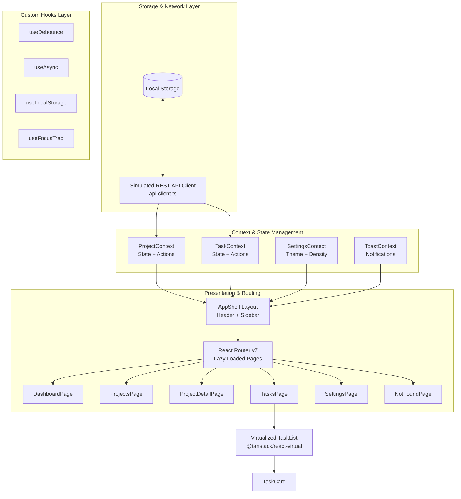

<div align="center">

# 📋 TaskBoard — Collaborative Project & Task Manager
### Modern, High-Performance React 19 Enterprise Task Management System

[](https://react.dev/)
[](https://www.typescriptlang.org/)
[](https://vite.dev/)
[](https://reactrouter.com/)
[](https://vitest.dev/)
[](https://tanstack.com/virtual/latest)
[](#license)

<p align="center">
  A production-grade React application featuring advanced state management, virtualized lists for rendering 1,000+ items at 60fps, code splitting, comprehensive test coverage, dark/light theming, and accessible UI components.
</p>

[Explore Features](#-key-features) • [Architecture](#-system-architecture) • [Getting Started](#-getting-started) • [Testing](#-testing--quality-assurance) • [Performance](#-performance-optimizations)

---

</div>

## 📖 Table of Contents

- [Overview](#-overview)
- [Key Features](#-key-features)
- [System Architecture](#-system-architecture)
- [Project Directory Structure](#-project-directory-structure)
- [Tech Stack & Dependencies](#-tech-stack--dependencies)
- [Getting Started & Execution Steps](#-getting-started--execution-steps)
- [Available Scripts](#-available-scripts)
- [Testing & Quality Assurance](#-testing--quality-assurance)
- [Performance Optimizations](#-performance-optimizations)
- [Accessibility & UI Design System](#-accessibility--ui-design-system)
- [GitHub Upload Guide](#-github-upload-guide)
- [Author & Acknowledgments](#-author--acknowledgments)

---

## 🌟 Overview

**TaskBoard** is a complete enterprise-grade project and task management dashboard designed to demonstrate modern React best practices. Built on **React 19**, **TypeScript**, and **Vite**, the application showcases:

- **Decoupled State Architecture**: State and action dispatchers separated into modular React Contexts to prevent unnecessary re-renders.
- **Ultra-Fast Virtualization**: Smooth scrolling and DOM recycling using `@tanstack/react-virtual` allowing seamless rendering of thousands of records.
- **Resilient Error Handling**: Route-level and component-level React `ErrorBoundary` wrappers paired with dynamic Toast notifications and Loading Skeletons.
- **Realistic Client-Side API Layer**: Built-in mock REST client with artificial network latency (200–600ms), simulated network faults, and `localStorage` persistence.

---

## 🚀 Key Features

### 📊 1. Analytics & Executive Dashboard
- **Metric Cards**: Real-time counts of total tasks, pending items, completed tasks, and high-priority alerts.
- **Project Progress Bars**: Automatic calculation and visual rendering of percentage completion across all registered projects.
- **Recent Activity Stream**: Live feed displaying recently updated tasks sorted chronologically.

### 📁 2. Project Lifecycle Management
- **Full Project CRUD**: Create, view, edit, and delete projects with metadata (client, category, due date, status).
- **Dedicated Project Detail View**: Deep-dive view displaying linked tasks, team members assigned, and completion statistics.
- **Filtering & Search**: Fast client-side searching across project names and descriptions.

### ✅ 3. Advanced Task Board
- **Status Workflows**: Categorized into `To Do`, `In Progress`, and `Completed`.
- **Priority Matrix**: `Low`, `Medium`, and `High` urgency classification with accessible color-coded badges.
- **Team Assignment**: Direct assignment to mock team members with avatar indicators.
- **View Modes**: Toggle between **List View** and **Grid/Card View**.

### ⚡ 4. High-Performance Virtualized List
- Uses `@tanstack/react-virtual` row virtualization.
- Only renders visible items in the DOM viewport (~15–20 elements at a time) rather than thousands of simultaneous DOM nodes, maintaining steady 60fps performance.

### 🔍 5. Real-Time Filtering & Debounced Search
- Debounced text search (`useDebounce`) across task titles and descriptions.
- Multi-dimensional filtering by status, priority, and team member assignee.
- Sortable by creation date, due date, priority level, and title (ascending/descending).

### 🎨 6. Theming & Personalization
- **Theme Switcher**: Instant transition between Light and Dark modes with CSS variables.
- **Layout Density**: Toggle between **Comfortable** and **Compact** density modes.
- **Preferences Persistence**: Automatically saves user layout settings to `localStorage`.

---

## 🏛 System Architecture

The following diagram illustrates the unidirectional data flow, context separation, and component hierarchy:



### Context Separation Pattern
To prevent component re-render cascades, context consumers are decoupled:
```typescript
// State and actions are partitioned into individual hooks
const { tasks, loading, error } = useTaskState(); // Only triggers re-render when data changes
const { createTask, updateTaskStatus } = useTaskActions(); // Stable references, won't trigger re-render
```

---

## 📂 Project Directory Structure

```text
EMPN2484_React_Advanced_Assignment/
├── index.html                   # HTML5 Entry Point with meta tags & SEO structure
├── package.json                 # Project dependencies, scripts, and configurations
├── tsconfig.json                # TypeScript compiler configuration
├── vite.config.ts               # Vite configuration with Vitest integration
├── public/                      # Static assets & favicon icons
└── src/
    ├── api/                     # Simulated API & persistence layer
    │   ├── api-client.ts        # Async delay simulation, error wrapper, storage bridge
    │   ├── project-api.ts       # Project CRUD API operations
    │   ├── task-api.ts          # Task CRUD API operations
    │   └── seed-data.ts         # Initial mock dataset (projects, tasks, members)
    ├── components/              # Shared design system components
    │   ├── feedback/            # Toast, ErrorBoundary, LoadingSpinner, EmptyState
    │   ├── layout/              # AppShell, Navigation Sidebar, Header, Quick Stats
    │   ├── modal/               # Accessible Modal dialogs with focus trapping
    │   └── ui/                  # Button, Input, Select, Badge, Avatar, ProgressBar
    ├── features/                # Domain-driven modular features
    │   ├── dashboard/           # Metrics overview, progress graphs, recent feeds
    │   ├── project-detail/      # Individual project management & linked tasks
    │   ├── projects/            # Project listing, creation modal, ProjectContext
    │   ├── settings/            # Appearance & density settings, SettingsContext
    │   └── tasks/               # Task management, TaskContext, TaskCard, TaskFilters
    ├── hooks/                   # Reusable custom hooks
    │   ├── use-async.ts         # Handles promise lifecycle (data, loading, error)
    │   ├── use-debounce.ts      # Debounced input values for real-time search
    │   ├── use-focus-trap.ts    # Accessibility hook for keyboard trap inside modals
    │   └── use-local-storage.ts # Type-safe synchronized localStorage state
    ├── pages/                   # Global fallback pages (NotFoundPage / 404)
    ├── routes/                  # React Router configuration with React.lazy
    ├── types/                   # Centralized TypeScript models & interfaces
    └── utils/                   # Pure helper functions (date formatting, validators)
```

---

## 🛠 Tech Stack & Dependencies

| Category | Technology | Version | Purpose |
| :--- | :--- | :--- | :--- |
| **Framework** | [React](https://react.dev/) | `19.2.8` | Core UI component model and reactive rendering |
| **Language** | [TypeScript](https://www.typescriptlang.org/) | `~6.0.2` | Strict compile-time typing and domain modeling |
| **Build Tool** | [Vite](https://vite.dev/) | `8.2.0` | Ultra-fast HMR and optimized asset bundling |
| **Routing** | [React Router](https://reactrouter.com/) | `7.18.2` | Client-side routing with lazy code splitting |
| **Virtualization** | [TanStack Virtual](https://tanstack.com/virtual) | `3.14.10` | High-performance virtualized list rendering |
| **Testing Engine** | [Vitest](https://vitest.dev/) | `4.1.11` | Blazing-fast Vite-native unit testing runner |
| **DOM Testing** | [Testing Library](https://testing-library.com/) | `16.3.2` | User-centric React component test utilities |
| **Environment** | [jsdom](https://github.com/jsdom/jsdom) | `29.1.1` | Headless browser DOM simulation for tests |

---

## ⚡ Getting Started & Execution Steps

Follow these steps to set up and run the application locally on your machine.

### Prerequisites

Ensure you have **Node.js** and **npm** installed on your system:
- **Node.js**: `v18.0.0` or higher (Tested on `v24.12.0`)
- **npm**: `v9.0.0` or higher (Tested on `v11.6.4`)

Verify your installation:
```bash
node -v
npm -v
```

---

### Step-by-Step Installation & Run

#### 1. Clone or Open the Workspace
```bash
git clone https://github.com/<your-username>/<your-repo-name>.git
cd EMPN2484_React_Advanced_Assignment
```

#### 2. Install Dependencies
```bash
npm install
```

#### 3. Start the Development Server
```bash
npm run dev
```
The terminal will display the local development URL:
```text
  VITE v8.2.2  ready in 454 ms

  ➜  Local:   http://localhost:5173/
  ➜  Network: use --host to expose
```
Open **[http://localhost:5173/](http://localhost:5173/)** in your browser.

#### 4. Build for Production
To produce a minified, production-ready build:
```bash
npm run build
```
The compiled assets will be output to the `dist/` folder.

#### 5. Preview Production Build Locally
To test the production build locally before deployment:
```bash
npm run preview
```

---

## 📜 Available Scripts

| Script | Command | Description |
| :--- | :--- | :--- |
| `npm run dev` | `vite` | Starts the local dev server with Hot Module Replacement (HMR) |
| `npm run build` | `tsc && vite build` | Type-checks with TypeScript compiler and generates production bundle |
| `npm run preview` | `vite preview` | Runs a local web server serving the production `dist/` bundle |
| `npm test` | `vitest run` | Runs all unit and component test suites once |
| `npm run test:watch` | `vitest` | Runs tests in interactive watch mode for active development |
| `npm run test:ui` | `vitest --ui` | Launches the interactive browser-based Vitest visual test runner |

---

## 🧪 Testing & Quality Assurance

The codebase includes comprehensive unit and integration tests using **Vitest** and **React Testing Library**:

- **Component Tests**: Validates user events, rendering states, badge indicators, and interaction callbacks (`TaskCard.test.tsx`).
- **Custom Hook Tests**: Tests state persistence and synchronization with browser storage (`useLocalStorage.test.tsx`).
- **Utility Logic Tests**: Verifies date helpers, status validators, and sorting algorithms (`task-utils.test.ts`).

### Running the Test Suite
```bash
# Run all tests once
npm test

# Expected Output:
# ✓ src/utils/task-utils.test.ts (6 tests)
# ✓ src/hooks/useLocalStorage.test.tsx (3 tests)
# ✓ src/features/tasks/components/TaskCard.test.tsx (4 tests)
# Test Files  3 passed (3)
# Tests       13 passed (13)
```

---

## ⚡ Performance Optimizations

1. **Route Code Splitting**:
   All major pages are lazy-loaded via `React.lazy()` and wrapped in `React.Suspense` inside `src/routes/index.tsx`, shrinking the initial payload and ensuring fast First Contentful Paint (FCP).
2. **DOM Virtualization (`@tanstack/react-virtual`)**:
   In `TaskList.tsx`, instead of instantiating thousands of nodes, only visible rows are rendered with calculated dynamic transforms.
3. **Debounced Search Inputs**:
   Search queries utilize `useDebounce` with a 300ms threshold to prevent rapid re-filtering and unnecessary state computations on every keystroke.
4. **Fine-Grained Context Subscription**:
   Separated state data and action callbacks so components that only dispatch actions do not re-render when state changes.

---

## ♿ Accessibility & UI Design System

- **Accessible Focus Trap**: All modal dialogs implement `useFocusTrap` to keep keyboard navigation locked inside the dialog when open and restore focus upon closing.
- **ARIA Compliance**: Role attributes (`role="dialog"`, `role="list"`, `role="listitem"`), `aria-modal="true"`, and `aria-label` descriptors are integrated across interactive controls.
- **Color Contrast & Responsive Design**: Compliant with WCAG standards across both dark and light modes with fluid layouts for mobile, tablet, and desktop viewports.

---

## 📤 GitHub Upload Guide

To upload this repository to your GitHub profile, execute the following commands in your project root:

```bash
# 1. Stage all project files
git add .

# 2. Commit the changes
git commit -m "feat: complete enterprise React task management application"

# 3. Add your remote GitHub repository
git remote add origin https://github.com/<your-username>/<your-repo-name>.git

# 4. Push to the main branch
git push -u origin main
```

---

## 📄 License

This project is licensed under the [MIT License](LICENSE).

---

<div align="center">
  <sub>Built with ❤️ using React 19, Vite, and TypeScript.</sub>
</div>
